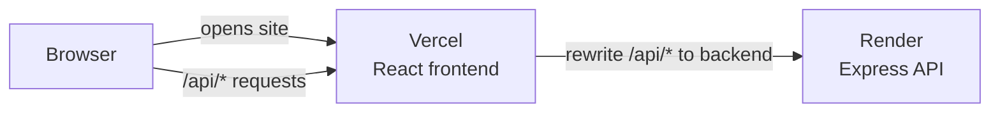
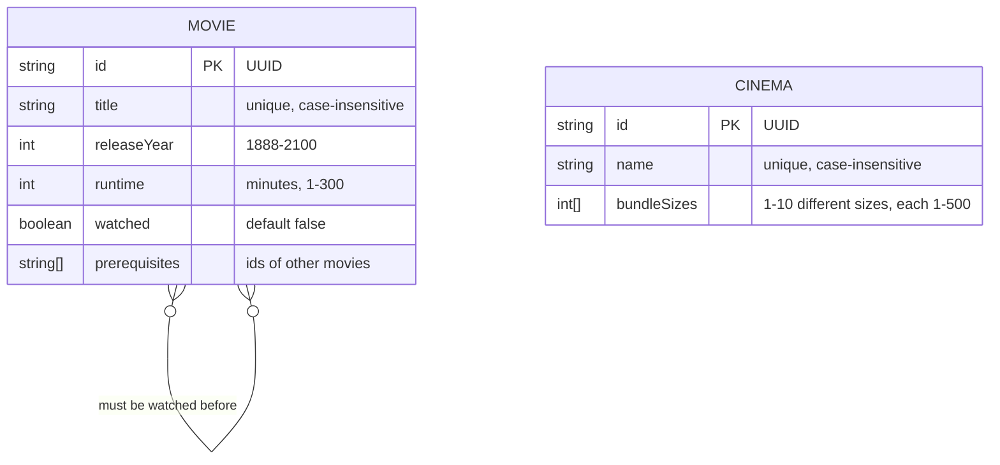

# Doomsday Ready

A small full-stack app that helps MCU fans plan their rewatch before *Avengers: Doomsday* and book an opening-night watch party.

| | |
|---|---|
| **Live demo** | https://doomsday-ready-liard.vercel.app |
| **API (backend)** | https://doomsday-ready-ik37.onrender.com/api (try `/api/health` or `/api/movies`) |

> **Note:** the backend runs on a free Render plan, which goes to sleep when idle. The first request after a quiet period can take 30–60 seconds. If the page says "Could not load data", wait a moment and press **Try again**.
> Data is kept in memory, so it resets to the sample data whenever the backend restarts.

---

## Table of contents

1. [What the app does](#what-the-app-does)
2. [Tech stack](#tech-stack)
3. [How it is deployed](#how-it-is-deployed)
4. [Project structure](#project-structure)
5. [Run it locally](#run-it-locally)
6. [Run with Docker](#run-with-docker)
7. [Tests](#tests)
8. [Data model](#data-model)
9. [API reference](#api-reference)
10. [How the two algorithms work](#how-the-two-algorithms-work)
11. [Frontend](#frontend)
12. [Assumptions and decisions](#assumptions-and-decisions)
13. [How I used AI](#how-i-used-ai)

---

## What the app does

### Feature 1: Movies and rewatch order
- Create movies with a **unique title**, release year, runtime (1–300 minutes), optional **prerequisites** (movies to watch first) and a **watched** flag (default `false`).
- Prerequisites and watched can be changed later.
- A movie can never depend on itself, directly or through other movies. Any create or update that would cause this is rejected with **`409 CIRCULAR_DEPENDENCY`**.
- **Rewatch order:** for a target movie, returns every movie needed before it (prerequisites, their prerequisites, and so on), each exactly once, in an order where every movie comes after its own prerequisites. The target is not included. The response also contains how many of those movies are watched and the total runtime of the unwatched ones.

### Feature 2: Cinemas and watch-party booking
- Create cinemas with a **unique name** and 1–10 different **bundle sizes** (each 1–500 seats).
- **Booking quote:** for a cinema and a group size (1–10,000), returns the **fewest bundles** whose seats add up to **exactly** the group size, and how many of each size to buy. If no exact combination exists, it says so.

### Feature 3: Frontend
A React app with three views:
1. **Movies:** add, edit (including prerequisites), delete, tick as watched, search and filter.
2. **Rewatch Plan:** pick a target movie and see the ordered list with watched ticks, a progress bar ("3 of 7 watched") and the remaining watch time.
3. **Booking ("Watch party"):** pick a cinema, enter a group size, and see the bundles to buy or "Not possible". New cinemas can be added from this page.

---

## Tech stack

| Part | Technology |
|---|---|
| Frontend | React 19, Vite, React Router, lucide-react icons, plain CSS |
| Backend | Node.js 22, Express 4, plain JavaScript (ES modules) |
| Storage | In-memory (`Map`), seeded on start |
| Tests | Node's built-in test runner (`node --test`), no extra packages |
| Hosting | Frontend on Vercel, backend on Render |
| Containers | Docker Compose (nginx for the frontend, Node for the backend) |

The cycle check, rewatch order and booking logic are written by hand. No graph, topological-sort or knapsack library is used.

---

## How it is deployed



- The React app is served by **Vercel**.
- `frontend/vercel.json` rewrites every `/api/*` request to the **Render** backend, so the browser only talks to one origin (no CORS problems), and rewrites all other paths to `index.html` so React Router pages still work after a refresh.

---

## Project structure

```
doomsday-ready/
├── README.md
├── docker-compose.yml
├── backend/
│   ├── package.json
│   ├── Dockerfile
│   ├── src/
│   │   ├── index.js                 # starts the server, seeds data
│   │   ├── app.js                   # express app, routes, error handling
│   │   ├── errors.js                # ApiError (status + code + message)
│   │   ├── routes/                  # movies.js, cinemas.js
│   │   ├── services/                # movieService, cinemaService, bookingService
│   │   ├── graph/
│   │   │   ├── cycle.js             # circular dependency check (algorithm 1a)
│   │   │   └── rewatchOrder.js      # rewatch order (algorithm 1b)
│   │   ├── booking/minBundles.js    # minimum bundles, DP (algorithm 2)
│   │   └── store/                   # in-memory store and seed data
│   └── tests/                       # algorithm tests and API tests
└── frontend/
    ├── package.json
    ├── vite.config.js               # dev proxy: /api -> localhost:3000
    ├── vercel.json                  # production rewrites
    ├── Dockerfile, nginx.conf
    └── src/
        ├── main.jsx, App.jsx
        ├── components/Layout.jsx    # sidebar, top bar
        ├── context/DataContext.jsx  # shared movie and cinema state
        ├── pages/                   # Movies.jsx, RewatchPlan.jsx, Booking.jsx
        ├── services/                # api.js (switch), mockBackend.js (demo mode)
        ├── utils/algorithms.js      # used only by demo mode
        └── styles.css
```

---

## Run it locally

Requirements: **Node.js 20.19+** (or 22.12+) and npm.

Open two terminals.

**Terminal 1: backend**
```bash
cd backend
npm install
npm run dev
```
The API runs on http://localhost:3000 (check http://localhost:3000/api/health).

**Terminal 2: frontend**
```bash
cd frontend
npm install
npm run dev
```
Open http://localhost:5173. The Vite dev server forwards `/api` to `http://localhost:3000`.

### Demo mode (no backend needed)
`frontend/src/services/api.js` has one switch:

```js
export const USE_DEMO_DATA = false; // false = real API, true = runs in the browser (localStorage)
```

With `true`, the whole app works without a backend using a browser-based copy of the logic (`mockBackend.js` and `utils/algorithms.js`). That code exists **only** to power demo mode. The real logic lives in the backend. The top bar shows **LIVE API** or **DEMO MODE**.

---

## Run with Docker

Requires Docker Desktop. From the project root:

```bash
docker compose up --build
```

Then open http://localhost:8080 (the API is also on http://localhost:3000/api). Stop with `Ctrl + C`, then `docker compose down`.

- `backend` image: Node 22, runs `node src/index.js`, with a health check on `/api/health`.
- `frontend` image: builds the React app, serves it with nginx, and proxies `/api/` to the `backend` container.

---

## Tests

```bash
cd backend
npm test
```

**38 tests**, covering:

- **Cycle detection:** self dependency, direct and indirect cycles, a long chain, diamond shapes (not a cycle), valid changes.
- **Rewatch order:** empty result, target excluded, prerequisites first, each movie once, and a 20,000-movie chain (no stack overflow).
- **Booking:** all four challenge examples, a case where greedy fails but DP succeeds, edge cases (1 seat, 500 seats, impossible sizes), seats always add up exactly, and max group size runs fast.
- **API:** status codes (200, 201, 204, 400, 404, 409), validation, duplicate titles and names, `409 CIRCULAR_DEPENDENCY` leaves data unchanged, watched updates change the rewatch stats, delete cleans up prerequisites, booking validation.

The API tests start their own app on a free port, so they do not clash with a running dev server.

### Challenge examples that are verified

| Request | Result |
|---|---|
| Rewatch order for *Avengers: Doomsday* | 7 other movies, prerequisites first (total runtime 1000 min) |
| Rewatch order for *Captain America: Civil War* | Iron Man and The First Avenger, then The Avengers |
| Rewatch order for *Thor: Ragnarok* | empty list |
| Make *Avengers: Endgame* a prerequisite of *Iron Man* | `409 CIRCULAR_DEPENDENCY` |
| Sizes `1, 3, 4`, group 6 | 2 bundles: 3 × 2 |
| Sizes `2, 5`, group 11 | 4 bundles: 5 × 1, 2 × 3 |
| Sizes `6, 9, 20`, group 44 | 4 bundles: 20 × 1, 9 × 2, 6 × 1 |
| Sizes `4, 6`, group 7 | not possible |

---

## Data model



- A movie points to other movies through `prerequisites` (a list of ids). This forms a directed graph that must never contain a cycle.
- A cinema only stores its bundle sizes. A **booking quote is calculated on request** from those sizes and the group size, and is not stored.

Example movie:
```json
{
  "id": "6b37043f-2a97-4f00-9165-6a2132078420",
  "title": "The Avengers",
  "releaseYear": 2012,
  "runtime": 143,
  "prerequisites": ["<Iron Man id>", "<The First Avenger id>"],
  "watched": false
}
```

---

## API reference

All endpoints are under `/api`.

| Method and path | Purpose |
|---|---|
| `GET /health` | Health check |
| `POST /movies` | Create a movie |
| `GET /movies` | List movies |
| `PATCH /movies/:id` | Update a movie (including `watched` and `prerequisites`) |
| `DELETE /movies/:id` | Delete a movie (extra endpoint) |
| `GET /movies/:id/rewatch-order` | Rewatch order, watched count, remaining runtime |
| `POST /cinemas` | Create a cinema |
| `GET /cinemas` | List cinemas |
| `GET /cinemas/:id/booking?groupSize=6` | Booking quote |

### Examples

**Create a movie**
```http
POST /api/movies
{ "title": "Black Widow", "releaseYear": 2021, "runtime": 134, "prerequisites": [] }
```
→ `201` with the new movie (`watched: false` by default).

**Update prerequisites or watched**
```http
PATCH /api/movies/:id
{ "watched": true }
{ "prerequisites": ["<movie id>", "<movie id>"] }
```

**Rewatch order**
```http
GET /api/movies/:id/rewatch-order
```
```json
{
  "order": [ { "title": "Iron Man", "...": "..." }, "...7 movies, prerequisites first..." ],
  "watchedCount": 0,
  "totalCount": 7,
  "remainingRuntime": 1000
}
```

**Booking quote**
```http
GET /api/cinemas/:id/booking?groupSize=11     (bundle sizes 2 and 5)
```
```json
{
  "possible": true,
  "groupSize": 11,
  "totalBundles": 4,
  "breakdown": [ { "size": 5, "count": 1 }, { "size": 2, "count": 3 } ]
}
```
When no exact combination exists:
```json
{ "possible": false, "groupSize": 7, "totalBundles": 0, "breakdown": [] }
```

### Errors

Every error has the same shape: `{ "error": "CODE", "message": "..." }`.

| Status | `error` | When |
|---|---|---|
| 400 | `VALIDATION_ERROR` | Bad or missing field, unknown prerequisite id, invalid `groupSize`, invalid JSON |
| 404 | `NOT_FOUND` | Unknown movie or cinema id, or unknown route |
| 409 | `DUPLICATE_TITLE` | A movie with this title already exists |
| 409 | `DUPLICATE_NAME` | A cinema with this name already exists |
| 409 | `CIRCULAR_DEPENDENCY` | The update would make a movie depend on itself, directly or indirectly |
| 500 | `INTERNAL_ERROR` | Unexpected server error |

---

## How the two algorithms work

### 1. Movies: circular dependency and rewatch order

**Circular dependency check** (`backend/src/graph/cycle.js`)

Before saving new prerequisites `P` for movie `X`, the code walks the prerequisite graph starting from `P` with an iterative depth-first search and a `visited` set. If `X` is reached, saving would create a cycle, so the request is rejected with `409 CIRCULAR_DEPENDENCY` and **nothing is changed**. This also catches `X` depending on itself. Complexity is O(V + E).

Example: giving *Iron Man* the prerequisite *Endgame* follows Endgame → Infinity War → Civil War → The Avengers → Iron Man, and so is rejected.

A new movie cannot create a cycle on creation, because nothing depends on its brand-new id yet. Cycles can only appear on update.

**Rewatch order** (`backend/src/graph/rewatchOrder.js`)

A post-order depth-first search from the target, using an explicit stack instead of recursion (so a very long chain cannot overflow the call stack). A movie is added to the result only **after all of its prerequisites**, so prerequisites always come first. The `visited` set makes sure every movie appears exactly once. The target itself is not included. The watched count and the remaining runtime (sum of runtimes of unwatched movies) are then calculated from that list.

### 2. Cinemas: fewest bundles for an exact group size (`backend/src/booking/minBundles.js`)

This is the minimum coin change problem, solved with dynamic programming.

- `dp[n]` = the fewest bundles that give exactly `n` seats, with `dp[0] = 0`.
- For each `n` from 1 to the group size and each bundle size `s <= n`: `dp[n] = min(dp[n], dp[n - s] + 1)`.
- `used[n]` remembers which bundle size gave the best value for `n`.
- If `dp[groupSize]` is still infinite, no exact combination exists.
- Otherwise the code walks back from `groupSize` through `used[]` to count how many of each size to buy.

A greedy approach (always take the biggest bundle) is **wrong**: with sizes `1, 3, 4` and group `6`, greedy gives `4 + 1 + 1` (3 bundles), but the correct answer is `3 + 3` (2 bundles).

Complexity is O(groupSize × number of sizes), at most 10,000 × 10, which runs in a few milliseconds.

---

## Frontend

- **Layout:** sidebar navigation, top bar showing the data mode, three routed pages.
- **State:** `DataContext` loads movies and cinemas once and shares them, so a change on the Movies page (for example ticking *watched*) is reflected on the Rewatch Plan page.
- **Movies page:** card grid, search, filter (all / watched / unwatched), add and edit in a dialog with prerequisite chips. A `CIRCULAR_DEPENDENCY` response is shown as a clear warning message. Delete asks for confirmation.
- **Rewatch Plan page:** target selector, progress bar and percentage, remaining time as hours and minutes, and a timeline of movies with tick circles. Clicking a circle toggles *watched*, and the plan refreshes.
- **Booking page:** cinema selector, guest counter with +/− buttons and a number field (1–10,000), result card with the bundle breakdown or "Not possible", and a dialog to add a new cinema.
- **Errors and loading:** loading state, error screen with a retry button, and friendly messages for API errors.

---

## Assumptions and decisions

Where the task was open to interpretation, these are the choices I made:

- **Storage is in memory** (a `Map`), for simplicity. Data resets on restart and is seeded with the challenge's 8 sample movies and 4 sample cinemas.
- **Ids are UUID strings.** Prerequisites store movie **ids**, not titles, so renaming a movie is safe.
- **Titles and cinema names are unique, compared case-insensitively** (`iron man` clashes with `Iron Man`).
- `releaseYear` must be a whole number from 1888 to 2100. `runtime` must be a whole number from 1 to 300.
- `PATCH` with `prerequisites` **replaces** the whole list. Duplicate ids in the list are ignored. Unknown ids give `400`.
- **No partial updates.** All fields are validated, and the cycle check is done, before anything is saved. A `400` or `409` leaves the movie unchanged.
- **Bundle sizes in one cinema must be different** from each other (the task says "different bundle sizes"). They are stored sorted ascending.
- A booking quote that is **not possible returns `200`** with `possible: false`, because it is a valid answer and not an error. An invalid `groupSize` (not a whole number, or outside 1–10,000) returns `400`.
- `groupSize` is accepted only as plain digits (`6abc`, `6.5`, an empty value and negative numbers are rejected).
- `DELETE /movies/:id` is an **extra** endpoint. It also removes the deleted movie from other movies' prerequisites.
- The frontend has a **demo mode** (see above) so it can run without a backend. The real logic is in the backend.
- Free-tier hosting: the backend sleeps when idle, so the first request can be slow.

---

## How I used AI

The challenge allows AI tools as long as their use is explained, so here is an honest account.

**Tool:** Claude (by Anthropic), used through a chat conversation.

**How I worked:** I asked Claude to explain the task in simple terms, then to guide me **one step at a time**, with the exact commands and what to check after each step. I ran every step on my own computer (VS Code and PowerShell), checked the results, and reported errors back until things worked.

**What AI helped with**

| Area | Help from AI |
|---|---|
| Understanding the task | Explained the requirements, the three features and the bonus items, and proposed a plan (backend, frontend, tests, README, Docker). |
| Frontend | Wrote the React + Vite UI (layout, three pages, shared state, styling), an API layer with a demo-mode switch, and fixed my uploaded frontend project so every feature worked. |
| Backend structure | Suggested the Express project structure (routes, services, store, error handling) and wrote the validation and endpoints step by step. |
| The two algorithms | Drafted the cycle check, the rewatch order (post-order DFS) and the minimum-bundles dynamic programming, and explained how each one works. |
| Tests | Wrote the 38 backend tests (algorithms and API) and checked them against the challenge's expected results. |
| Docker, README, deployment | Drafted the Dockerfiles, `docker-compose.yml`, this README, and walked me through pushing to GitHub and deploying to Render and Vercel. |
| Debugging | Helped me read errors (for example port already in use, wrong folder, PowerShell quoting, stale ids after a server restart) and fix them. |

**What I did myself**

- Set up the project and folders, typed and saved the files, and ran all commands.
- Ran the manual API tests in PowerShell and the automated tests (`npm test`) and confirmed the challenge's expected results.
- Made the decisions about the stack (everything in JavaScript to match my React project) and tested the finished app in the browser.
- Created the GitHub repository and the Render and Vercel deployments, and connected them.

**Limits and honesty notes**

- Most of the code was generated by AI from my requests and then run and tested by me. It was not written from scratch by hand.
- The AI-generated code was verified by running it. I checked the results against the examples in the task, and the automated tests pass.
- The demo-mode copy of the logic in the frontend is a temporary stand-in for the real backend, and is clearly separated in the code.
